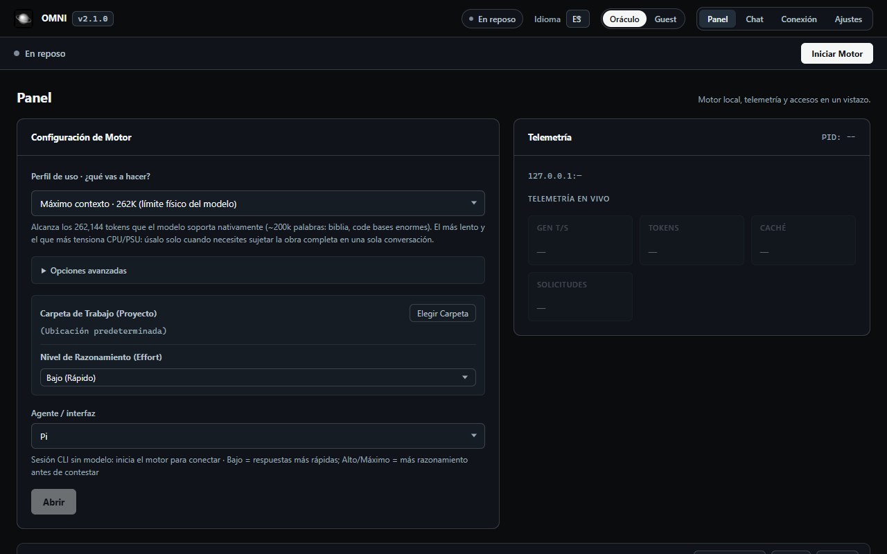
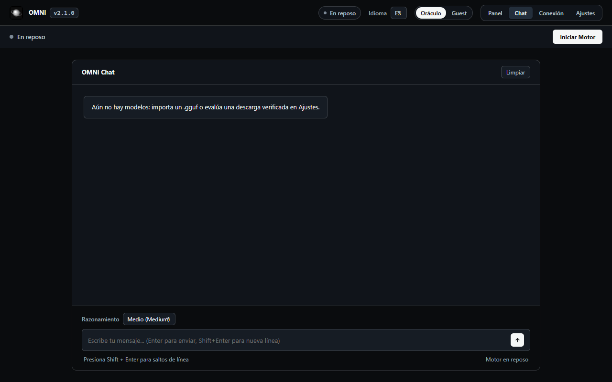
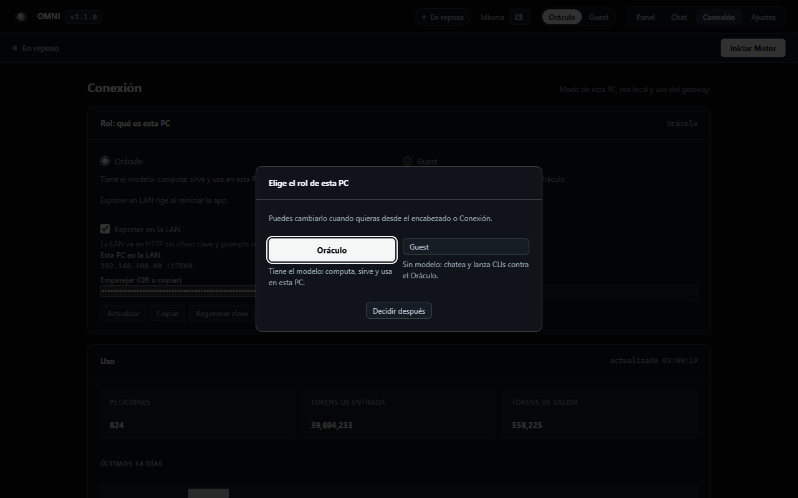

# OMNI — Tu IA local en Windows, sin terminal

Un único ejecutable que pone un modelo grande a trabajar en **tu GPU**:
chat nativo con streaming, API compatible con OpenAI en loopback y
lanzadores de agentes (Pi, OMP, OpenCode, DeepSeek) con todo ya configurado.
Tus prompts no salen de tu PC. Sin terminal: todo se opera desde la app.

## Por qué OMNI

| | OMNI | Nube pública | Chat web + Docker |
|---|---|---|---|
| Tus datos salen de tu PC | **No** — todo en loopback | Sí | A medias |
| Funciona sin internet | **Sí** (tras descargar el modelo) | No | Requiere imagen + terminal |
| Hay que configurar CLIs | **No** — un clic los deja listos | N/A | A mano |
| Actualizaciones | **Automáticas** en la app (con rollback) | — | A mano |
| Terminal | **Nunca** | — | Siempre |

## Empezar en 5 minutos

1. Descarga el ZIP `OMNI-portable-<versión>-<fecha>.zip` de
   [GitHub Releases](https://github.com/getodevel-source/LocalMind/releases)
   y extráelo donde quieras (p. ej. `C:\OMNI`), o instala con
   `packaging/install.ps1` en `%LOCALAPPDATA%\Programs\OMNI`
   (no requiere administrador).
2. Copia tus `.gguf` a `models/` junto a `OMNI.exe`
   (o impórtalos desde Ajustes → Modelos; el botón **Evaluar** te dice
   si caben en tu GPU antes de descargar).
3. Ejecuta `OMNI.exe`. En SmartScreen pulsa
   «Más información → Ejecutar de todos modos» (sin firma de código).
4. En el Panel pulsa **Arrancar** y chatea en la tab Chat.

## Lo que hace

- **Chat local con razonamiento visible** — streaming, bloque *thinking*
  colapsable, detener, copiar código. Bilingüe es/en.
- **API OpenAI-compatible** (`/v1/chat/completions`, `/v1/messages`,
  `/v1/responses`) con tu clave local: cualquier herramienta compatible
  se conecta a `http://127.0.0.1:<puerto>/v1`.
- **Agentes en un clic** — Pi, OMP, OpenCode, DeepSeek y web se abren con
  el modelo, la clave y la carpeta de proyecto ya puestos.
- **Telemetría en vivo** — t/s, tokens, caché, %MTP, PID; aviso si el
  motor cargó lento y puerta de aceptación que verifica la GPU.
- **Actualización automática** — chequeo silencioso, descarga verificada
  por SHA256, instalación al salir con rollback `.prev` si algo falla.
- **Cuida tu PC** — auto-stop por inactividad (libera VRAM), anti-apagón
  (cooldown + tope de arranques), sin consola ni ventanas extra.

## Requisitos

- Windows 10/11 de 64 bits con WebView2 (lo trae Edge).
- GPU con Vulkan (probado en AMD RX 6800 XT 16 GB); con menos VRAM usa
  un `.gguf` más pequeño (el Evaluador te guía).
- Puertos libres: gateway `127.0.0.1:17860` (+10 intentos) y motor
  `llama_port` (default 8080).

## Docs

- [`docs/MANUAL.md`](docs/MANUAL.md) — manual de usuario (instalación,
  primer arranque, actualización, datos y desinstalación; con quick start
  en inglés).
- [`packaging/README.md`](packaging/README.md) — layout del ZIP,
  instalador/desinstalador, canal de auto-update, troubleshooting.
- [`tests/README.md`](tests/README.md) — harnesses y contrato de tests.
- [`CHANGELOG.md`](CHANGELOG.md) — cambios por versión (Keep a Changelog).
- [`docs/SRS.md`](docs/SRS.md) — especificación del sistema.

## Estado

Versión actual: ver [`src-rust/Cargo.toml`](src-rust/Cargo.toml) y
[`CHANGELOG.md`](CHANGELOG.md). `cargo test` 212/0 + `cargo fmt` +
`cargo clippy -D warnings`, `tests/ui-render.mjs` 97 PASS,
`tests/smoke.mjs` 17/17 en vivo. CI en `.github/workflows/ci.yml`;
release por tag `vX.Y.Z`.
