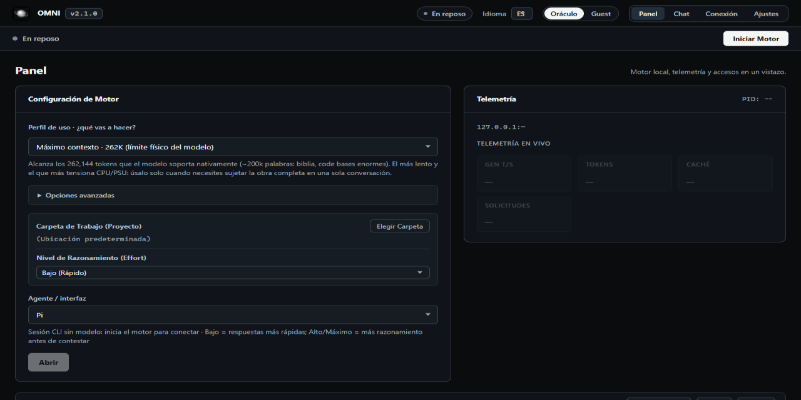

  
  <h1>OMNI</h1>
  
<strong>IA local para Windows. Tus modelos corren en tu equipo.</strong>

  
Chat, API compatible con OpenAI y agentes listos para usar, desde una sola aplicación.

  

    <a href="https://github.com/getodevel-source/OMNI/releases/latest">Descargar OMNI</a>
    · <a href="docs/MANUAL.md">Leer el manual</a>
    · <a href="docs/README.md">Explorar la documentación</a>
  

  

    
    
    
    
  

  

OMNI ejecuta modelos GGUF en tu PC y ofrece una interfaz de escritorio para chatear, administrar modelos y conectar herramientas. El chat y la API usan el motor local; las descargas de modelos y actualizaciones necesitan Internet. El acceso desde otros equipos de la red es opcional.

## Qué puedes hacer

| Área | Qué ofrece |
|---|---|
| **Chat y modelos** | Streaming y razonamiento visible. Importa modelos `.gguf` o evalúa si entran en la memoria de tu GPU antes de descargarlos. |
| **API local** | Conecta clientes compatibles con OpenAI al gateway local. Incluye `/v1/chat/completions`, `/v1/responses` y `/v1/messages`. |
| **Agentes** | Abre Pi, OMP, OpenCode o DeepSeek con el modelo, la clave y la carpeta de trabajo configurados. |
| **Control y actualizaciones** | Consulta uso y telemetría, detén el motor cuando no lo uses y recibe actualizaciones verificadas con SHA-256 y recuperación ante fallos. |

### Chat en la aplicación

  

## Inicio rápido

1. Descarga el ZIP portable desde [Releases](https://github.com/getodevel-source/OMNI/releases/latest) y extráelo, por ejemplo, en `C:\OMNI`.
2. Abre `OMNI.exe`. En el primer inicio, Windows puede mostrar SmartScreen porque la aplicación aún no está firmada.
3. En **Modelos**, importa un archivo `.gguf` o evalúa y descarga un modelo compatible. Después, vuelve al **Panel**, selecciónalo y pulsa **Iniciar Motor**.
4. Abre **Chat** para conversar o consulta el [manual](docs/MANUAL.md) para configurar agentes, conexión en red y actualizaciones.

Los modelos no vienen dentro del ZIP. El espacio necesario depende del modelo, su cuantización y el contexto elegido; el evaluador de la aplicación ayuda a comprobarlo antes de descargar.

## Requisitos

- Windows 10 u 11 de 64 bits y WebView2.
- GPU compatible con Vulkan. El proyecto se ha probado en una AMD RX 6800 XT de 16 GB; el uso de memoria depende del modelo.
- Una conexión a Internet para descargar la aplicación, modelos o futuras actualizaciones. Una vez descargado el modelo, el chat local puede usarse sin conexión.

Por defecto, el gateway escucha en `127.0.0.1:17860` y el motor en el puerto configurado (8080 si está libre). La exposición a la LAN se activa desde **Conexión**.

## Recorre el repositorio

| Ruta | Qué contiene |
|---|---|
| [`src-rust/`](src-rust/) | Aplicación de escritorio, motor de procesos, API local y lógica de actualización. |
| [`ui.html`](ui.html) | Interfaz principal que se muestra dentro de la ventana. |
| [`assets/omni/`](assets/omni/) | Iconos y recursos de marca. |
| [`packaging/`](packaging/) | Scripts para generar el ZIP portable e instalar o desinstalar OMNI. |
| [`tests/`](tests/) | Pruebas de UI, integración, actualización y herramientas de rendimiento. |
| [`.github/workflows/`](.github/workflows/) | Flujos de CI y publicación de versiones. |
| [`docs/`](docs/) | Manuales, especificaciones, auditorías, capturas y notas técnicas. |

La guía de documentación explica por dónde empezar según tu tarea: [abrir el índice de docs](docs/README.md).

## Documentación

- [Manual de usuario](docs/MANUAL.md): instalación, primer inicio, modelos, actualización y datos.
- [Empaquetado y mantenimiento](packaging/README.md): ZIP portable, instalador, canal de actualización y solución de problemas.
- [Pruebas](tests/README.md): suites disponibles y cómo ejecutarlas.
- [Especificación del sistema](docs/SRS.md): requisitos y contratos técnicos.
- [Registro de cambios](CHANGELOG.md): novedades por versión.

## Versiones y actualizaciones

Consulta la [última versión publicada](https://github.com/getodevel-source/OMNI/releases/latest). Al crear un tag `vX.Y.Z`, GitHub Actions ejecuta las comprobaciones y construye el ZIP portable. OMNI detecta las versiones nuevas desde **Ajustes → Actualización**; los modelos y los datos del usuario se conservan durante la instalación.

---

OMNI · modelos locales, interfaz sencilla, control en tu equipo.

